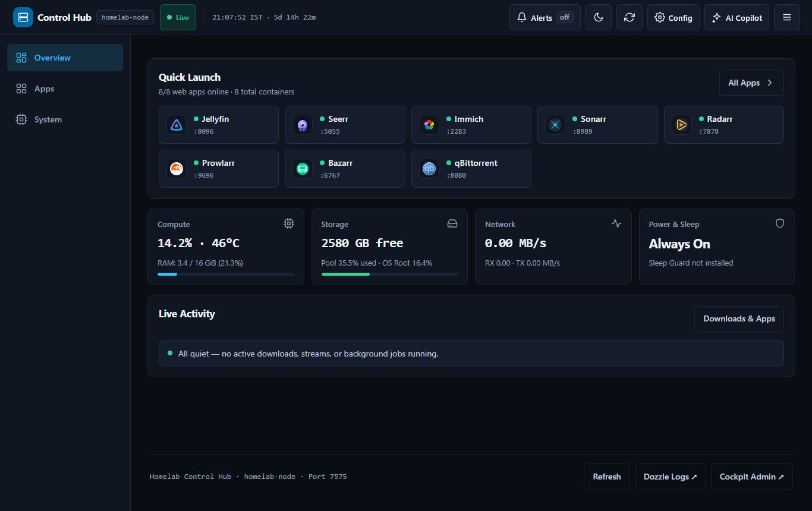
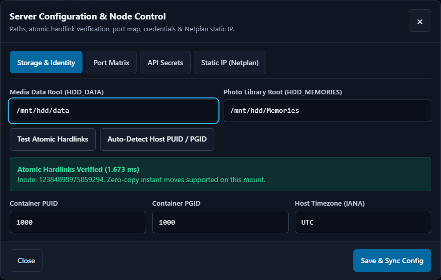
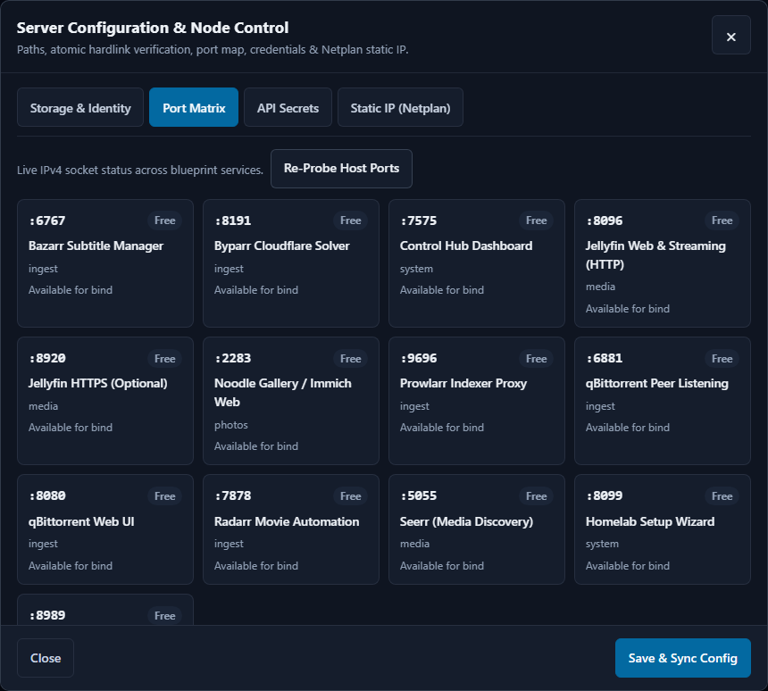
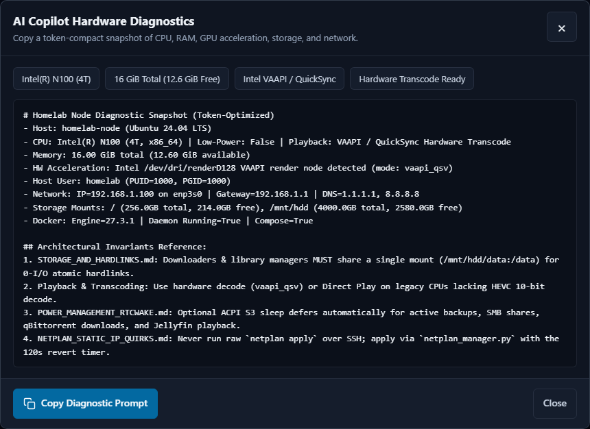

# Control Hub 🚀

> High-performance, ultra-lightweight homelab command center and active node management daemon tailored for low-power hardware.  
> Runs on **< 25 MB RAM** and **< 0.2% CPU** with zero Node.js/npm dependencies.

[](https://github.com/RAM-MAHESHWARI24/control-hub/actions/workflows/ci.yml)
[](https://github.com/RAM-MAHESHWARI24/control-hub/releases)
[](https://www.python.org/)
[](https://opensource.org/licenses/MIT)
[](#performance)
[](docs/openapi.yaml)
[](#quickstart)

---

## 🌟 Why Control Hub?

Most homelab dashboards (Homarr, Homepage, Dashy) are heavy, static bookmark managers packaged in 200MB+ Docker images with continuous Node.js runtime overhead. 

**Control Hub** is an **active server management daemon** built with Python Flask and modular Vanilla ES6. It gives you real-time hardware telemetry, active power control, live container logs, day-to-day node configuration, and an integrated AI copilot while sipping resources on low-power hardware (such as 2-core Haswell mini-PCs or Intel N100s).



---

## 📦 Complete Feature & Widget Catalog

Control Hub is organized into modular Python backend widgets (`widgets/`) and matching ES6 frontend controllers:

### 1. 🛌 Sleep Guard Hero Card (`widgets/sleep_guard.py`)
* **Real-Time Suspend Telemetry:** Displays tonight's scheduled suspend time (default 00:00 IST) and hardware RTC wake alarm (06:00 IST).
* **1-Click Sleep Inhibition:** Toggle `/run/server-suspend.skip` directly from the UI to prevent sleep tonight without touching SSH.
* **Dynamic Time Shifting:** Push tonight's sleep time back by **+1 Hour** or **+2 Hours** on the fly via `/run/server-suspend.override`.
* **Process-Aware Deferral:** Automatically monitors background backup jobs (`immich_backup_gdrive.sh`, `rclone`, `pg_dumpall`) and defers sleep until completion.

### 2. ⚡ Live Network Telemetry (`widgets/network_speed.py`)
* Non-blocking background sampler computing true delta Rx/Tx bandwidth from `/sys/class/net/<active_nic>/statistics`.
* Cached Ookla Speedtest results (`speedtest_cache.json`) for ISP sanity checking.

### 3. 📥 qBittorrent Ingest Monitor (`widgets/current_downloads.py`)
* Live download speeds, remaining ETA, and completion percentages.
* 1-Click download queue pause and resume.

### 4. 📸 Immich & Noodle Backup Monitor (`widgets/backup_sync.py`)
* Reads only `status.json` from the backup script (no `sudo rclone`): last good run and its age, next run, Drive usage, the last 7 runs, and what retention kept and will delete next.
* Turns red when the last run failed, was interrupted, or the last good run is older than 26 hours (`BACKUP_STALE_HOURS`). A failed pre-flight lists each check and why it failed.
* "Run backup now" starts the same script as the nightly job and shows its log live.
* **Change remote**: pick another rclone remote (and optional folder), **Test** it (it must answer; the dialog says which backup folders it already has and warns when the whole photo library would be uploaded), then **Save**. Both backups switch from their next run. Needs the blueprint's root helper `homelab-backup-remote`; hidden otherwise.
* **Restore test**: the result of the monthly test that restores the newest remote dump into a throwaway database (photos counted against the dump), when it runs next, and **Run restore test now**. A failed test turns the card red and sends a critical alert.
* A **Media app settings** row shows the media module's nightly settings backup (databases and config of the media apps) with **Back up now** (`MEDIA_BACKUP_SCRIPT`, `MEDIA_BACKUP_STATUS_FILE`).
* Displays master photo and video library storage consumption.

### 4b. 🔔 Alerts (`widgets/alerts.py`, `core/alerts.py`)
* Sends a message when something needs attention: photo backup failed, interrupted or older than 26 hours; backup remote not reachable (Drive login expired); a disk over 85% or 95%; an app stopped or unhealthy for 5 minutes; CPU above 80 °C for 2 minutes; a TV app update failed; too many failed dashboard sign-ins.
* Channels: ntfy (phone app, no account; the dashboard can generate a private topic), Telegram, Discord and email (SMTP), each with a **Send test** button.
* Each alert is sent once, repeated after 24 hours if still open, and followed by "Resolved" when it clears. During quiet hours (default 23:00 to 07:00) only critical alerts go out; the rest arrive as one message when quiet hours end. An optional daily summary goes out at a set time.
* Setup for every channel: [Control Hub Alerts guide](https://github.com/RAM-MAHESHWARI24/homelab-blueprint/blob/develop/docs/CONTROL_HUB_ALERTS.md).
* Rules are checked every minute in one background thread. Settings and state live in `ALERTS_CONFIG_FILE` / `ALERTS_STATE_FILE` (0600, default the Control Hub state directory).

### 5. 📊 System Vitals & Hardware Gauges (`widgets/system_vitals.py`)
* Real-time CPU load, memory utilization, swap headroom, and thermal temperatures.
* **Universal Hardware Detection:** Dynamically probes host CPU model name, thread count, physical RAM, and storage mount headroom without hardcoded hardware assumptions.

### 6. 💾 Storage Operations & Inodes (`widgets/storage_ops.py`)
* Visual gauges for primary root storage (NVMe/SSD) and secondary storage pool (HDD/SATA).
* Real-time read/write I/O throughput with dynamic block device resolution (`/dev/nvme*`, `/dev/sd*`, `/dev/vd*`).

### 7. ⏰ Scheduled Cron Tasks (`widgets/cron_tasks.py`)
* Visual inspection of system cron jobs (nightly ML scheduler, daily Recyclarr sync, photo backup, TV auto-updater).

### 8. 📜 Service Matrix & Container Logs (`widgets/service_matrix.py`)
* Lists only the containers that exist on this host (plus Cockpit when its socket is active), with filter counts built from that list.
* Restart a container (the service account is in the `docker` group, no sudo) and read its recent logs inline. A Dozzle link appears only when a `dozzle` container exists.

### 9. 📺 Android TV Fleet Preview (`widgets/tv_updater.py`)
* Status and sync state of background ADB app updates for the TVs in the TV auto-updater profile. The online count and the device list come from the same data.

---

## ⚙️ Integrated Node Configuration Center (`widgets/config_center.py`)

Accessible via the header button **⚙️ Settings** (`btn-open-config-center`), this 5-tab modal allows operators to inspect and reconfigure the homelab on the fly without editing `.env` files manually:



### Tab 1: Storage & Atomic Hardlinks
* Real-time `os.link` hardlink inode validation probe with millisecond latency measurement.
* Live directory path modification for Media Root (`DATA_ROOT_HOST`), Photo Storage (`MEMORIES_ROOT_HOST`), and App Configs (`CONFIG_ROOT_HOST`).

### Tab 2: 13-Service Port Matrix & Connectivity Prober
* Live socket-level prober testing all 13 core homelab ports simultaneously.
* Real-time badges (`ACTIVE` in green, `INACTIVE` in amber) for Jellyfin (8096), Seerr (5055), Sonarr (8989), Radarr (7878), Prowlarr (9696), Bazarr (6767), qBittorrent (8080/6881), Immich (2283), Control Hub (7575), Cockpit (9090), and Dozzle (8888).



### Tab 3: Security & Secrets Generator
* 1-Click CSPRNG generator for high-entropy alphanumeric passwords and 32-character hex API keys for all *arr services and PostgreSQL.

### Tab 4: Safe Netplan Static IP Manager
* Inspects active network interface, gateway, and DNS servers.
* Generates clean Ubuntu Netplan YAML.
* Applies the change with an armed revert timer and keeps it only after confirmation from the new address, so you never get locked out over SSH.

### Tab 5: Setup Wizard Fast Launcher
* 1-Click button to launch the zero-dependency Onboarding Setup Wizard on port `8000` for full cluster re-provisioning.

---

## 🤖 Built-in AI Copilot Modal

Accessible via the header button **🤖 AI Copilot** (`btn-open-ai-copilot`), this drawer empowers operators pairing with AI coding assistants (ChatGPT, Claude, Cursor, Antigravity):



* **Hardware Intelligence Extraction:** Gathers host CPU model, core/thread count, physical memory, active IP, and `/dev/dri` GPU render node status.
* **1-Click Prompt Exporter:** Generates a dense, token-optimized context prompt (~300 tokens) ready to copy/paste into an LLM session.
* **Quick Reference Runbooks:** Direct links to offline technical markdown runbooks (`STORAGE_AND_HARDLINKS.md`, `POWER_MANAGEMENT_RTCWAKE.md`, etc.).

---

## 🔌 REST API Documentation

### Observability & Health Probing Endpoints

| Method | Endpoint | Description |
| :--- | :--- | :--- |
| `GET` | `/api/health` | Standard service health status, version, and uptime |
| `GET` | `/api/livez` | Kubernetes-style liveness probe (checks event loop responsiveness) |
| `GET` | `/api/readyz` | Kubernetes-style readiness probe (checks storage and telemetry subsystems) |
| `GET` | `/api/docs` | Interactive Swagger UI API documentation portal |
| `GET` | `/api/openapi.yaml` | Raw OpenAPI 3.1.0 machine-readable contract |

### System & Telemetry Endpoints

| Method | Endpoint | Description |
| :--- | :--- | :--- |
| `GET` | `/api/system/vitals` | Real-time CPU, RAM, Swap, and disk capacity metrics |
| `GET` | `/api/network/speed` | True Rx/Tx bandwidth deltas for `ACTIVE_NIC` |
| `GET` | `/api/storage/ops` | Real-time disk I/O throughput |
| `GET` | `/api/downloads/status` | Active qBittorrent downloads, speeds, and ETAs |
| `GET` | `/api/backup/status` | Immich backup and Google Drive sync status |
| `GET` | `/api/alerts` | Alert channels, rules, open alerts and recent history |
| `PUT` | `/api/alerts/config` | Save alert channels, rules and quiet hours |
| `POST` | `/api/alerts/test` | Send a test message to one channel |
| `POST` | `/api/alerts/check` | Check every alert rule now |
| `POST` | `/api/backup/media/run` | Back up the media apps' settings now |
| `POST` | `/api/backup/restore-test` | Start the photo backup restore test now |
| `GET` | `/api/backup/remotes` | rclone remotes on the server and the one in use |
| `POST` | `/api/backup/remote/test` | Test a remote (answers, space, existing folders) |
| `PUT` | `/api/backup/remote` | Switch both backups to another remote |
| `GET` | `/api/services/status` | Health status and container IDs for all services |
| `GET` | `/api/services/logs/<service>?tail=50` | Direct Docker log stream |
| `GET` | `/api/tv/status` | Android TV fleet ADB update status |
| `PUT` | `/api/tv-updater/devices/<id>/nickname` | Give a TV a nickname (empty shows the detected model) |

### Power Management Endpoints

| Method | Endpoint | Description |
| :--- | :--- | :--- |
| `GET` | `/api/power/sleep-status` | Tonight's scheduled suspend and RTC wake status |
| `POST` | `/api/power/skip-sleep` | Creates `/run/server-suspend.skip` to prevent sleep tonight |
| `POST` | `/api/power/shift-sleep` | Shifting tonight's suspend time by +1h or +2h |

### Configuration Center Endpoints (`widgets/config_center.py`)

| Method | Endpoint | Parameters / Body | Description |
| :--- | :--- | :--- | :--- |
| `GET` | `/api/config/current` | None | Returns active `.env` configuration dictionary |
| `POST` | `/api/config/update` | JSON payload of env key-values | Atomically writes updated settings to `.env` |
| `POST` | `/api/config/verify-hardlink` | `{"path": "/mnt/hdd/data"}` | Executes live `os.link` probe and measures latency |
| `GET` | `/api/config/ports` | None | Probes all 13 services and returns active/inactive status |
| `POST` | `/api/config/generate-secrets` | None | Generates cryptographically secure passwords & API keys |
| `GET` | `/api/config/ai-diagnostics` | None | Returns hardware specs and ~300-token preformatted AI prompt |
| `POST` | `/api/config/netplan-preview` | `{"ip": "...", "gateway": "..."}` | Generates clean Netplan YAML configuration |
| `POST` | `/api/config/netplan-apply` | `{"interface": "...", "ip": ".../24", "gateway": "...", "dns": [...]}` | Applies with a revert timer; confirm with `POST /api/config/netplan-confirm`, inspect with `GET /api/config/netplan-status` |

---

> This repository is a read-only mirror of a folder in [homelab-blueprint](https://github.com/RAM-MAHESHWARI24/homelab-blueprint), published on every release. Please open issues and pull requests there.

## 🚀 Quickstart & Standalone Deployment

Control Hub ships with the [homelab-blueprint](https://github.com/RAM-MAHESHWARI24/homelab-blueprint) installer. To run it on its own, next to an existing setup:

```bash
git clone https://github.com/RAM-MAHESHWARI24/control-hub.git
cd control-hub
./install.sh            # creates .env with a new access token and a Python venv
./run.sh                # starts the dashboard on port 7575
```

Or in Docker:

```bash
./install.sh --docker   # same .env, then docker compose up -d --build
```

The script prints the dashboard link with the token. Anyone holding the token controls the host, so keep it private. Then edit `.env`:

- `QBITTORRENT_URL`, `QBITTORRENT_USER`, `QBITTORRENT_PASS` for the downloads card. In Docker the default `http://host.docker.internal:8080` reaches a qBittorrent on the host.
- `BACKUP_DIR` for the backup card, where your photo backups land.
- `TV_UPDATER_DIR` and `TV_UPDATER_PY` only if you also run [tv-autoupdater](https://github.com/RAM-MAHESHWARI24/tv-autoupdater). Without them the TV card stays hidden.

---

## 🔧 Systemd Service Deployment

To run Control Hub as a hardened, unprivileged background daemon on Ubuntu:

```ini
# /etc/systemd/system/control-hub.service
[Unit]
Description=Control Hub (Custom Dashboard & API Engine)
After=network.target docker.service
Wants=docker.service

[Service]
Type=simple
User=homelab
Group=homelab
SupplementaryGroups=docker
WorkingDirectory=/opt/homelab-blueprint/apps/control-hub
EnvironmentFile=-/opt/homelab-blueprint/apps/control-hub/.env
ExecStart=/opt/homelab-blueprint/apps/control-hub/venv/bin/python3 /opt/homelab-blueprint/apps/control-hub/server.py
Restart=always
RestartSec=5
Environment=PYTHONUNBUFFERED=1

# Low-power resource bounds
CPUQuota=20%
MemoryMax=100M

[Install]
WantedBy=multi-user.target
```

Enable and start:
```bash
sudo systemctl daemon-reload
sudo systemctl enable --now control-hub.service
```

---

## 📄 License
MIT License. Part of the [Homelab Blueprint](https://github.com/RAM-MAHESHWARI24/homelab-blueprint) ecosystem.
